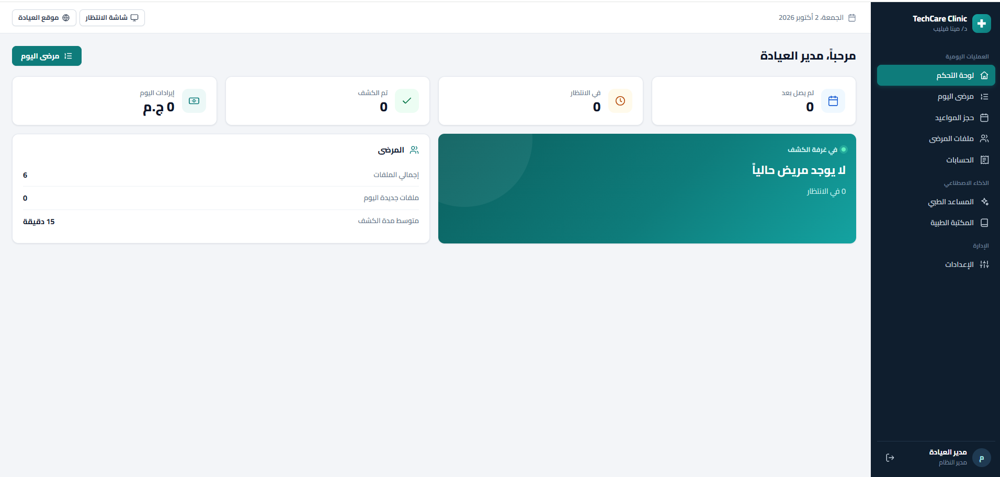
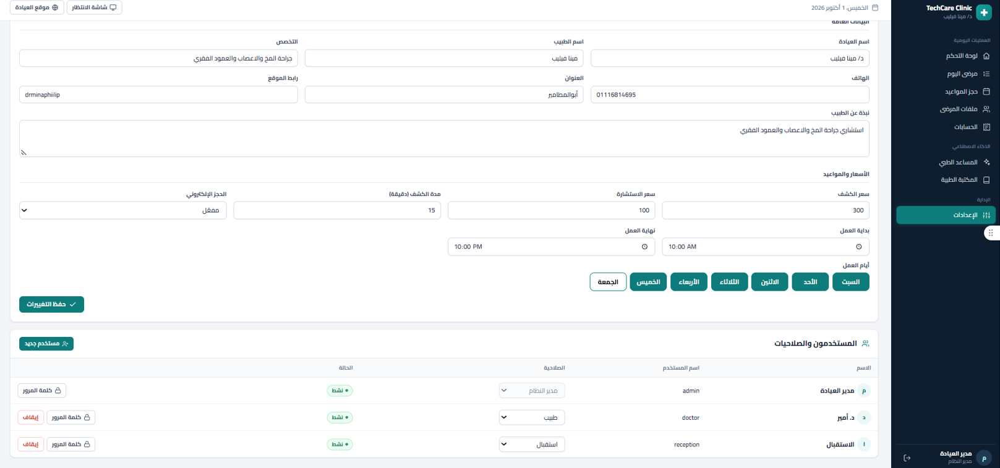
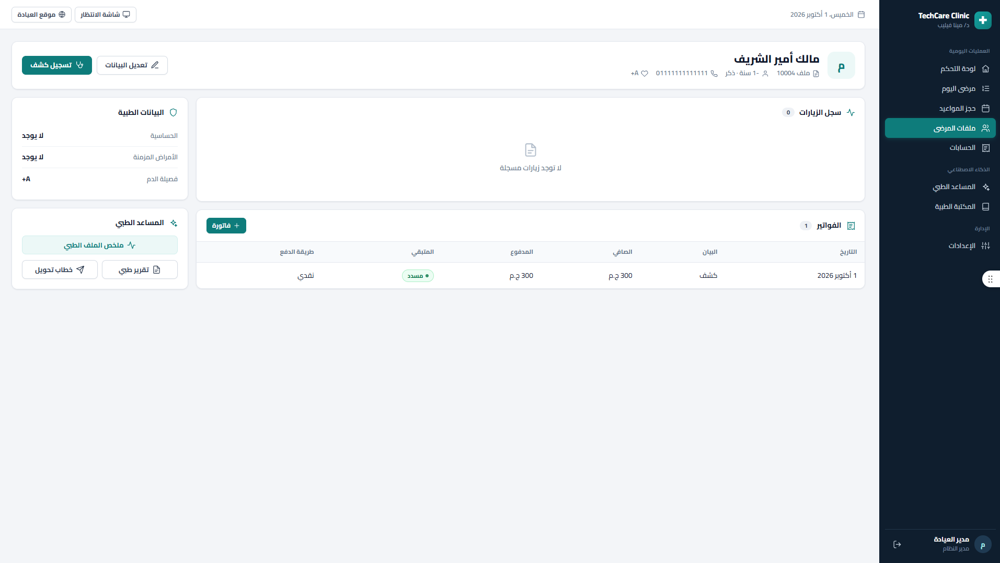
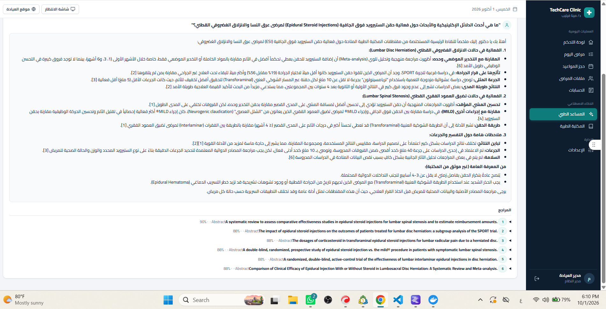
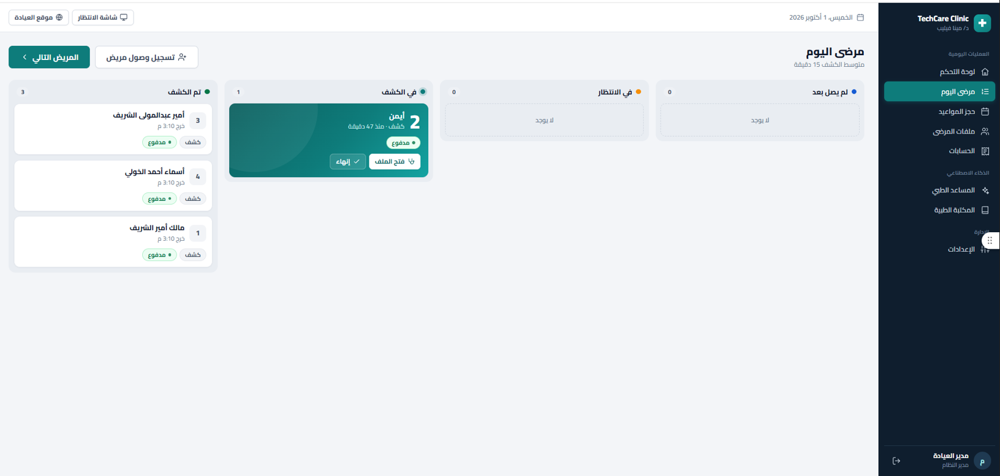
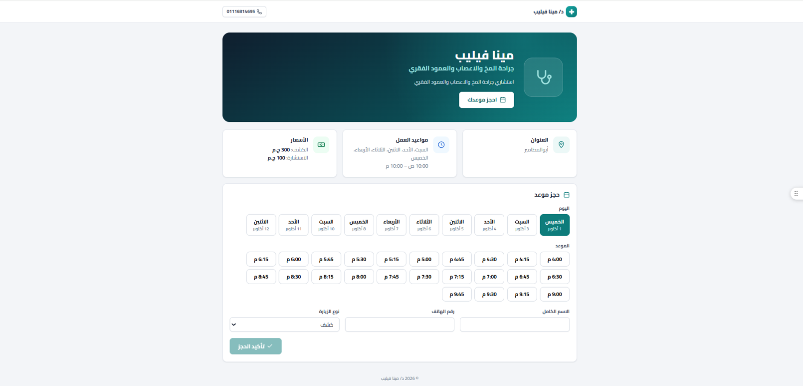

# TechCare Clinic

Complete Arabic (RTL) clinic management system for multiple clinics, with a smart queue, online booking, billing, and an AI medical assistant that answers from a medical library with sources.

## Features

**Daily clinic operations**
- Dashboard: today's patients, waiting, examined, and daily revenue
- Smart queue with a waiting-room display screen
- Appointments and a public online booking page for each clinic (clinic hours, visit slots, visit type)
- Patient files: medical data (allergies, chronic conditions, blood type), visit history, attachments
- Billing: invoices, payments, and remaining balance
- Medical report and referral letter generation, drug catalog

**Administration**
- Clinic settings: details, prices, visit duration, working days and hours, online booking on/off
- Users with roles and per-user permissions (admin, doctor, reception), password reset, disable accounts
- Audit log, patient data rights, and data retention handling

**Multi-clinic platform (owner panel)**
- Owner (super admin) manages clinics, subscriptions and trial periods
- Each clinic's data is isolated from the others
- Medical library management, event log, and AI usage tracking

**AI medical assistant**
- Answers clinical questions from a medical library (PubMed and clinical guidelines) and shows its sources
- Local LLM through LM Studio (Qwen), with an optional external model provider
- Optional vector search with PostgreSQL + pgvector
- Decision support only, it does not replace the doctor's judgment

## Tech stack

- Backend: C# / .NET 10, ASP.NET Core, Entity Framework Core, SQLite (PostgreSQL optional)
- Frontend: React + Vite (Arabic, right-to-left)
- AI: LM Studio (local Qwen model and embeddings), pgvector for vector search
- Tests: integration tests that run the API against an in-memory SQLite database, with a fake LLM client (no network needed)

## Project structure

- `backend/TechCare.Clinic.Api`: REST API, domain, features, infrastructure, migrations
- `backend/TechCare.Clinic.Api.Tests`: integration tests
- `frontend`: web UI
- `scripts`: helper scripts for testing and starting the vector database

## Getting started

Requirements: .NET SDK 10, Node.js (frontend only).

1. Copy `backend/TechCare.Clinic.Api/appsettings.Development.example.json` to `appsettings.Development.json` and replace every `CHANGE-ME` with your own values (JWT key and seed passwords).
2. Run the API:

```powershell
dotnet run --project backend/TechCare.Clinic.Api/TechCare.Clinic.Api.csproj
```

3. Run the frontend:

```powershell
cd frontend; npm install; npm run dev
```

4. Run the tests:

```powershell
dotnet test backend/TechCare.Clinic.Api.Tests/TechCare.Clinic.Api.Tests.csproj
```

## Status

Working prototype under active development. This repository contains the source code only. The database, patient files, logs and the medical library (guideline PDFs and PubMed data) are not included.

## Screenshots

All screenshots use demo data only.

### Dashboard


### Smart Queue


### Patient File


### AI Medical Assistant


### Online Booking Page


### Clinic Settings and Users

